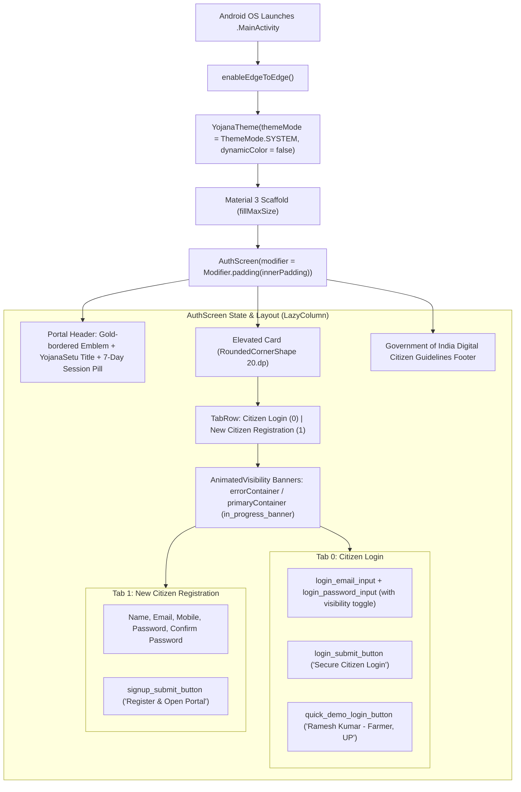
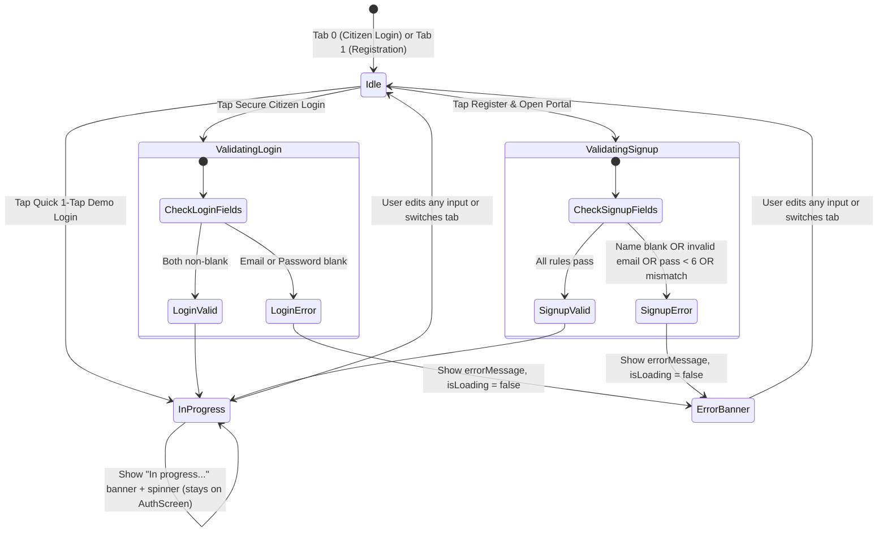

<div align="center">

# 📱 YojanaSetu • Android Application
### Native Jetpack Compose Citizen Authentication Portal

[](gradle/libs.versions.toml)
[](gradle/libs.versions.toml)
[](app/build.gradle.kts)
[](app/build.gradle.kts)
[](app/build.gradle.kts)

**Lightweight Material 3 Android module focused strictly on the Citizen Login and New Citizen Registration experience (`AuthScreen`), preserving the full YojanaSetu civic theme, validation, and pre-filled demo flow.**

[← Back to Root Repo](../README.md) · [View CI Workflow →](../.github/workflows/build-android.yml)

</div>

---

## 📋 Overview & Current Scope

This module is intentionally streamlined to a lean, dependency-light **Jetpack Compose + Material 3** authentication frontend with **zero database, network, or scheme-browsing screens**:

- **Entry Point (`MainActivity`)**: Enables edge-to-edge rendering and mounts `YojanaTheme(themeMode = ThemeMode.SYSTEM)` wrapping `AuthScreen` inside a Material 3 `Scaffold`.
- **Two Auth Flows (`AuthScreen`)**:
  1. **Citizen Login (`selectedTab = 0`)**: Pre-filled demo credentials (`ramesh.farmer@yojanasetu.gov.in`), password visibility toggle, blank-field validation, **Secure Citizen Login** button, and **Quick 1-Tap Login** card.
  2. **New Citizen Registration (`selectedTab = 1`)**: Full Name (as on Aadhaar), Email Address, Mobile Number, Create Password (min 6 chars), and Confirm Password with real-time validation.
- **Non-Navigating Progress Feedback**: Submitting valid credentials or tapping Quick 1-Tap Login remains on `AuthScreen` and renders an animated `"In progress..."` banner (`in_progress_banner`) and inline button spinner instead of navigating to any scheme page.

---

## 🏛️ Application & UI Architecture



---

## 🔄 Authentication Validation & State Flow



---

## 🎨 Theme & Design System

Configured in [`Theme.kt`](app/src/main/java/com/example/ui/theme/Theme.kt), [`Color.kt`](app/src/main/java/com/example/ui/theme/Color.kt), and [`Type.kt`](app/src/main/java/com/example/ui/theme/Type.kt) with `dynamicColor = false` by default to preserve the official government portal identity across all Android versions.

| Color Role | Light Token & Hex | Dark Token & Hex |
| :--- | :--- | :--- |
| **Primary** | `NavyPrimary` `#133B6B` | `DarkNavyPrimary` `#A6C8FF` |
| **Primary Container** | `NavyPrimaryContainer` `#D6E3FF` | `DarkNavyPrimaryContainer` `#004688` |
| **Secondary** | `AmberSecondary` `#C05621` | `DarkAmberSecondary` `#FFB68E` |
| **Tertiary** | `EmeraldTertiary` `#1B6A4C` | `DarkEmeraldTertiary` `#8AD5B2` |
| **Background** | `LightBackground` `#F8FAFC` | `DarkBackground` `#0B1320` |
| **Surface** | `LightSurface` `#FFFFFF` | `DarkSurface` `#111D30` |
| **Emblem Gold Accent** | `#FFC107` (border & shield icon) | `#FFC107` |

---

## 📂 Directory Structure

```text
Android_Application/
├── app/
│   ├── build.gradle.kts                           # Module configuration & minimal Compose dependencies
│   ├── proguard-rules.pro                         # ProGuard configuration
│   └── src/
│       ├── main/
│       │   ├── AndroidManifest.xml                # App manifest (.MainActivity launcher)
│       │   ├── java/com/example/
│       │   │   ├── MainActivity.kt                # Single-activity Compose entry point
│       │   │   └── ui/
│       │   │       ├── screens/AuthScreen.kt      # Citizen Login & Registration UI
│       │   │       └── theme/
│       │   │           ├── Color.kt               # Light & Dark palette tokens
│       │   │           ├── Theme.kt               # YojanaTheme & ThemeMode enum
│       │   │           └── Type.kt                # Material 3 Typography
│       │   └── res/                               # Launcher mipmaps, drawables, strings, XML rules
│       ├── test/java/com/example/
│       │   ├── ExampleRobolectricTest.kt          # Compose UI tests for Login & Registration flows
│       │   └── ExampleUnitTest.kt                 # Basic JVM unit test
│       └── androidTest/java/com/example/
│           └── ExampleInstrumentedTest.kt         # Android instrumentation context test
├── gradle/
│   ├── libs.versions.toml                         # Centralized dependency & plugin catalog
│   └── wrapper/gradle-wrapper.properties          # Gradle 9.3.1 distribution config
├── build.gradle.kts                               # Root Gradle plugins (android.application, kotlin.compose)
├── gradle.properties                              # JVM args (-Xmx4g), parallel, caching, nonTransitiveRClass
├── metadata.json                                  # Project metadata descriptor
└── settings.gradle.kts                            # Root project name ("YojanaSetu") & repos
```

---

## ⚙️ Build & Test Configuration

| Setting | Value |
| :--- | :--- |
| **Application ID** | `com.aistudio.yojanasetu.wvkmqx` |
| **Namespace** | `com.example` |
| **Compile SDK** | `36` (`minorApiLevel = 1`) |
| **Target SDK / Min SDK** | `36` / `24` |
| **Java Compatibility** | Java `11` |
| **Gradle / AGP / Kotlin** | Gradle `9.3.1` · AGP `9.1.1` · Kotlin `2.2.10` |
| **Test Stack** | JUnit 4 + Robolectric `4.16.1` (`@Config(sdk = [36])`) + Compose UI Test |

### Test Coverage ([`ExampleRobolectricTest.kt`](app/src/test/java/com/example/ExampleRobolectricTest.kt))
- `read string from context`: Verifies `R.string.app_name` equals `"YojanaSetu"`.
- `clicking login shows in progress and stays on auth screen`: Clicks `login_submit_button` with pre-filled demo credentials and asserts both `in_progress_banner` and `auth_screen` are displayed.
- `switching to signup tab and submitting valid form shows in progress`: Switches to `tab_signup`, enters valid registration details, submits `signup_submit_button`, and asserts `in_progress_banner` and `auth_screen` are displayed.

---

## 🚀 Building & Testing

### Option A: Automated Cloud Build (GitHub Actions)
Push to `main` or `master` (or run **Build Android Debug APK** manually in the **Actions** tab). The workflow in [`.github/workflows/build-android.yml`](../.github/workflows/build-android.yml) installs JDK 21, Android SDK `36.1`, and Gradle `9.3.1`, executes `:app:testDebugUnitTest assembleDebug`, and publishes **`yojanasetu-debug-apk`** (`app-debug.apk`).

### Option B: Local Build (Requires Android SDK `36.1` & JDK 17/21)
From `Android_Application/`:

```powershell
# Run unit & Robolectric Compose UI tests
gradle :app:testDebugUnitTest

# Build debug APK
gradle assembleDebug

# Install onto a connected Android device/emulator
adb install -r app/build/outputs/apk/debug/app-debug.apk
```
*(Ensure `ANDROID_HOME` is set or `local.properties` defines `sdk.dir=...`.)*
