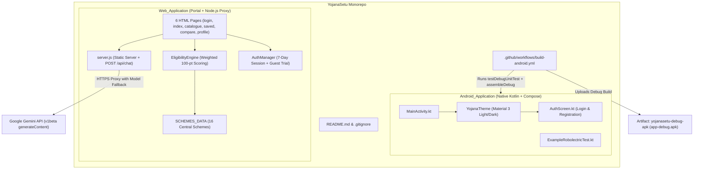

<div align="center">

# 🏛️ YojanaSetu • योजना सेतु
### Citizen Welfare Scheme Eligibility & Portal Ecosystem

[](.github/workflows/build-android.yml)
[](Android_Application/)
[](Web_Application/)
[](Android_Application/app/src/main/java/com/example/ui/theme/Theme.kt)

**A unified monorepo housing the YojanaSetu Citizen Welfare Portal across Web and Native Android.**  
*Designed with a dignified Government of India Navy & Warm Amber identity, 7-day citizen authentication flows, personalized eligibility evaluation across 16 central schemes, and Gemini-powered multilingual advisory.*

[Explore Android App →](Android_Application/README.md) · [Explore Web Portal →](Web_Application/README.md) · [CI/CD Workflow →](.github/workflows/build-android.yml)

</div>

---

## 📌 Repository Overview

This monorepo consolidates both client platforms and CI automation under a single repository:

| Module | Directory | Tech Stack | Current Scope | Documentation |
| :--- | :--- | :--- | :--- | :--- |
| **Android Application** | [`Android_Application/`](Android_Application/) | Kotlin, Jetpack Compose, Material 3, Gradle 9.3.1, AGP 9.1.1 | Citizen Login & New Citizen Registration Auth Portal (`AuthScreen`) with validation & `"In progress..."` state | [`Android_Application/README.md`](Android_Application/README.md) |
| **Web Application** | [`Web_Application/`](Web_Application/) | HTML5, CSS3, Vanilla ES Modules, Node.js HTTP Proxy | Full 6-page Welfare Portal, 16-scheme Weighted Eligibility Engine, Document Checklist, Comparison & YojanaMitra Gemini AI Proxy | [`Web_Application/README.md`](Web_Application/README.md) |
| **CI/CD Pipeline** | [`.github/workflows/`](.github/workflows/build-android.yml) | GitHub Actions (`ubuntu-latest`), JDK 21, Android SDK 36.1 | Automated Robolectric UI/Unit Tests + Debug APK build & artifact upload | [`build-android.yml`](.github/workflows/build-android.yml) |

---

## 🏗️ Monorepo System Architecture



---

## 🔄 End-to-End CI/CD & Developer Workflow

Because the repository builds the Android APK in the cloud via GitHub Actions, contributors can develop on any machine (including setups with only VS Code) and still retrieve verified, installable builds.

```mermaid
flowchart LR
    Dev["Developer (VS Code)"] -->|"git push (main / master)"| GitHub["GitHub Repository"]
    GitHub -->|"Triggers Workflow"| Runner["ubuntu-latest Runner"]
    Runner -->|"Step 1"| JDK["Setup JDK 21 (Temurin)"]
    JDK -->|"Step 2"| SDK["Accept Licenses & Install Android SDK 36.1"]
    SDK -->|"Step 3"| Gradle["Setup Gradle 9.3.1"]
    Gradle -->|"Step 4"| Test["gradle :app:testDebugUnitTest"]
    Test -->|"Step 5"| Build["gradle assembleDebug"]
    Build -->|"Step 6"| Artifact["Upload app-debug.apk"]
    Artifact -->|"Download from Actions Tab"| Phone["Install on Android Device"]
```



---

## 📂 Repository Tree

```text
yojanasetu/
├── .github/
│   └── workflows/
│       └── build-android.yml          # GitHub Actions CI: unit tests + debug APK artifact
├── .gitignore                         # Root ignore rules (node_modules, .env, .gradle, build, keystores)
├── README.md                          # You are here
│
├── Android_Application/               # Native Jetpack Compose Android app
│   ├── app/
│   │   ├── build.gradle.kts           # App module Gradle config (compileSdk 36.1, Compose BOM)
│   │   └── src/
│   │       ├── main/                  # MainActivity, AuthScreen, Material 3 Theme, Manifest, res/
│   │       ├── test/                  # Robolectric + Compose UI unit tests
│   │       └── androidTest/           # Instrumented test scaffold
│   ├── gradle/                        # Version catalog (libs.versions.toml) & wrapper properties
│   ├── build.gradle.kts               # Top-level Gradle plugins
│   ├── settings.gradle.kts            # Project name & repository resolution
│   └── README.md                      # Android module architecture & build guide
│
└── Web_Application/                   # Multi-page Web Portal + Node.js Gemini Proxy
    ├── css/styles.css                 # Shared Light/Dark responsive government portal styling
    ├── js/
    │   ├── data/schemesData.js        # 16 verified Indian Government welfare schemes
    │   ├── engine/
    │   │   ├── eligibilityEngine.js   # Weighted eligibility matching & ranking engine
    │   │   └── chatEngine.js          # Local RAG chatbot fallback logic
    │   ├── services/geminiService.js  # Proxy-first Gemini AI client
    │   ├── app.js                     # Multi-page UI controller & localStorage state
    │   ├── auth.js                    # 7-day session, registration & guest trial manager
    │   └── config.js                  # Shared portal metadata & optional API key config
    ├── login.html                     # Default entry page (Login / Registration / Guest Trial)
    ├── index.html                     # Dashboard, Hero Stats, & AI Advisor Drawer
    ├── catalogue.html                 # Searchable & filterable 16-scheme catalogue
    ├── saved.html                     # Bookmarked schemes management
    ├── compare.html                   # Side-by-side scheme comparison matrix
    ├── profile.html                   # Citizen demographic profile builder
    ├── server.js                      # Zero-config Node HTTP server & /api/chat Gemini proxy
    ├── package.json                   # Node ESM manifest (dotenv, express)
    └── README.md                      # Web architecture, API proxy & scoring docs
```

---

## 🎨 Shared Visual Identity

Both platforms share a cohesive Government of India civic design language:

| Token | Light Mode | Dark Mode | Role |
| :--- | :--- | :--- | :--- |
| **Primary (Dignified Navy)** | `#133B6B` | `#A6C8FF` | Headers, primary buttons, brand emblem, key focus states |
| **Secondary (Warm Amber)** | `#C05621` | `#FFB68E` | Accents, bilingual subtitles (`योजना सेतु`), badges & highlights |
| **Tertiary (Civic Emerald)** | `#1B6A4C` | `#8AD5B2` | Eligible badges, verified indicators, positive feedback |
| **Background** | `#F8FAFC` | `#0B1320` | Clean high-contrast canvas |
| **Surface** | `#FFFFFF` | `#111D30` | Elevated cards and authentication containers |

---

## 🚀 Quick Start

### 1. Run the Web Portal Locally
```bash
cd Web_Application
npm install
npm start
```
Open `http://localhost:3000` (auto-increments port if `3000` is busy). See [`Web_Application/README.md`](Web_Application/README.md) for configuring `GEMINI_API_KEY`.

### 2. Get the Android Debug APK (Cloud Build)
1. Push changes to `main` or `master` (or trigger **Build Android Debug APK** manually in the GitHub **Actions** tab).
2. Download the **`yojanasetu-debug-apk`** artifact from the completed workflow run.
3. Extract `app-debug.apk` and install it on an Android device (`minSdk 24` / Android 7.0+).

See [`Android_Application/README.md`](Android_Application/README.md) for full local Gradle build instructions.
