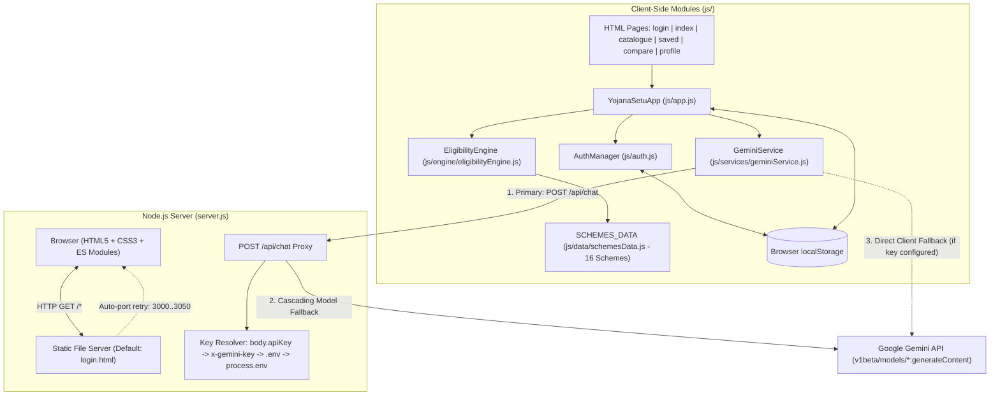
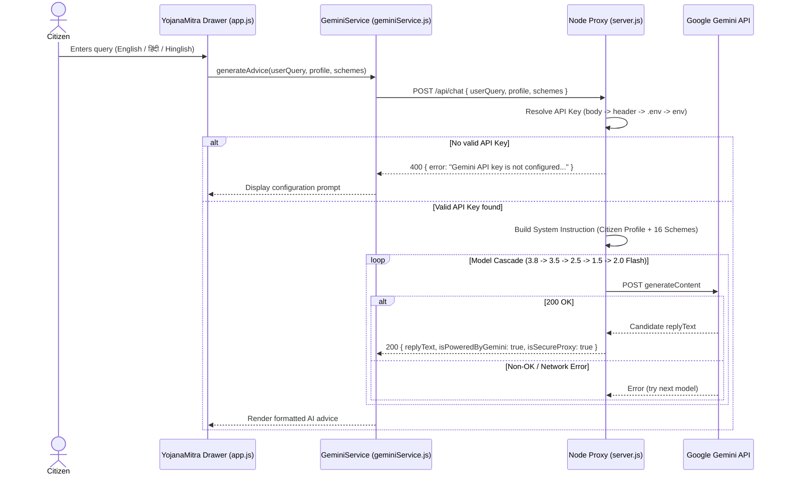

<div align="center">

# 🌐 YojanaSetu • Web Application
### National Citizen Welfare & Government Schemes Portal + Secure Gemini AI Proxy

[](server.js)
[](package.json)
[](js/data/schemesData.js)
[](server.js)

**A multi-page responsive web portal enabling Indian citizens to authenticate, build demographic profiles, evaluate scheme eligibility in real time, compare benefits side-by-side, track required documents, and chat with YojanaMitra AI in English, हिंदी, or Hinglish.**

[← Back to Root Repo](../README.md) · [Android Companion App →](../Android_Application/README.md)

</div>

---

## ✨ Key Capabilities

- **Multi-Page Citizen Portal**: Dedicated pages for Authentication (`login.html`), Home Dashboard (`index.html`), Searchable Catalogue (`catalogue.html`), Bookmarks (`saved.html`), Comparison Matrix (`compare.html`), and Profile Builder (`profile.html`).
- **Weighted Eligibility Engine**: Deterministic 100-point scoring across 6 demographic dimensions classifying every scheme as `ELIGIBLE`, `PARTIALLY_ELIGIBLE`, or `NOT_ELIGIBLE` with human-readable match reasons and missing criteria.
- **16 Verified Government Schemes**: Pre-loaded central & centrally-sponsored schemes across Agriculture, Healthcare, Housing, Business Loans, Education, Social Security, and Food Security.
- **Secure Backend Gemini Proxy (`server.js`)**: Keeps your `GEMINI_API_KEY` on the server (via `.env` or environment variables), injects the user's live profile and all 16 schemes into the system prompt, and automatically cascades across 5 Gemini Flash models.
- **Client-Side Persistence & Themes**: Stores active sessions (7-day expiry), citizen profile, saved schemes, comparison selections, document checklists, and Light/Dark theme preference in `localStorage`.

---

## 🏗️ Web & Proxy Architecture



---

## 🔄 AI Advisor (`POST /api/chat`) Request Sequence



---

## 🧮 Eligibility Scoring Engine (`EligibilityEngine`)

[`js/engine/eligibilityEngine.js`](js/engine/eligibilityEngine.js) evaluates each scheme against the active citizen profile using a weighted point model:

| Rule Dimension | Weight | Evaluation Rule |
| :--- | :---: | :--- |
| **Occupation** | **25 pts** | Matches `allowedOccupations` (or `"All"`) |
| **Gender** | **20 pts** | Matches `allowedGenders` (or `"All"`) |
| **Annual Income** | **20 pts** | `profile.annualIncome <= scheme.maxAnnualIncome` (or no cap) |
| **Age** | **15 pts** | Within `[minAge, maxAge]` range |
| **Social Category** | **10 pts** | Matches `allowedCategories` (or `"All"`) |
| **Landholding** | **10 pts** | Checked when `scheme.requiresLand === true` (`> 0` and `<= maxLandHectares`) |

### Classification & Sorting Logic
- **`ELIGIBLE`**: `missingCriteria.length === 0`
- **`PARTIALLY_ELIGIBLE`**: `missingCriteria.length === 1` AND `matchPercentage >= 70%`
- **`NOT_ELIGIBLE`**: All other cases
- Results in `evaluateAll()` are sorted by: **Status** (`ELIGIBLE` → `PARTIALLY_ELIGIBLE` → `NOT_ELIGIBLE`) → **Match % (descending)** → **Scheme Name (A–Z)**.

---

## 📚 Pre-Loaded Welfare Schemes (`SCHEMES_DATA`)

[`js/data/schemesData.js`](js/data/schemesData.js) ships with **16 verified schemes**:

1. `PM_KISAN` — PM Kisan Samman Nidhi
2. `AYUSHMAN_BHARAT` — Ayushman Bharat PM-JAY
3. `PMAY_GRAMIN` — Pradhan Mantri Awaas Yojana
4. `PM_MUDRA` — Pradhan Mantri Mudra Yojana (PMMY)
5. `SUKANYA_SAMRIDDHI` — Sukanya Samriddhi Yojana
6. `PM_VISHWAKARMA` — PM Vishwakarma Scheme
7. `POST_MATRIC_SCHOLARSHIP` — Post Matric Scholarship (SC/OBC/EBC)
8. `PM_SVANIDHI` — PM Street Vendor's AtmaNirbhar Nidhi
9. `ATAL_PENSION` — Atal Pension Yojana (APY)
10. `PM_UJJWALA` — Pradhan Mantri Ujjwala Yojana 2.0
11. `KISAN_CREDIT_CARD` — Kisan Credit Card (KCC)
12. `PRAGATI_SCHOLARSHIP` — AICTE Pragati Scholarship for Girls
13. `PM_JEEVAN_JYOTI` — PM Jeevan Jyoti Bima Yojana (PMJJBY)
14. `STAND_UP_INDIA` — Stand-Up India Scheme
15. `MGNREGA` — Mahatma Gandhi NREGA
16. `PM_GKAY_RATION` — PM Garib Kalyan Anna Yojana (NFSA Ration Card)

---

## 📂 Directory Structure

```text
Web_Application/
├── css/
│   └── styles.css                 # Tricolor civic top bar, Light/Dark CSS variables, responsive cards & drawer
├── js/
│   ├── data/
│   │   └── schemesData.js         # 16 structured Indian Government schemes with docs & steps
│   ├── engine/
│   │   ├── eligibilityEngine.js   # Weighted rule evaluator & sorter
│   │   └── chatEngine.js          # Local RAG chatbot fallback engine
│   ├── services/
│   │   └── geminiService.js       # Calls POST /api/chat proxy with client-side fallback
│   ├── app.js                     # Main controller (rendering, filters, bookmarks, compare, checklist, AI drawer)
│   ├── auth.js                    # AuthManager (7-day session, Google simulation, Guest Trial, route guard)
│   └── config.js                  # Shared CONFIG (PORTAL_NAME, VERSION, DEFAULT_MODEL, GEMINI_API_KEY)
├── login.html                     # Default route (/): Citizen Login, Registration & Guest Trial
├── index.html                     # Home Dashboard: Hero stats, profile bar, AI drawer & matches
├── catalogue.html                 # Full searchable & filterable scheme directory
├── saved.html                     # Saved/bookmarked schemes view
├── compare.html                   # Side-by-side comparison matrix
├── profile.html                   # Demographic profile editor & completeness tracker
├── server.js                      # Zero-config Node HTTP static server + Gemini /api/chat proxy
└── package.json                   # Node ESM config ("type": "module", scripts: start/dev)
```

---

## 🔐 Session & Storage Keys (`localStorage`)

| Key | Purpose |
| :--- | :--- |
| `yojanasetu_auth_session` | Active citizen or Guest Trial session (`timestamp`, `loginMethod`, 7-day expiry check) |
| `yojanasetu_citizen_profile` | Demographic fields (name, age, gender, state, occupation, income, landholding, BPL flag) |
| `yojanasetu_saved_schemes` | Array of bookmarked scheme IDs |
| `yojanasetu_compare_schemes` | Array of scheme IDs selected for side-by-side comparison |
| `yojanasetu_doc_checklist` | Per-scheme document readiness checkboxes |
| `yojanasetu_theme` | `"light"` or `"dark"` UI theme preference |
| `yojanasetu_gemini_key` | Optional client-entered Gemini API key fallback |

---

## 🚀 Running Locally

### 1. Install Dependencies
```bash
cd Web_Application
npm install
```

### 2. (Optional) Configure Gemini AI Key
Create a `.env` file inside `Web_Application/`:
```env
GEMINI_API_KEY=your_google_gemini_api_key_here
PORT=3000
```
*(If port `3000` is occupied, `server.js` automatically tries consecutive ports up to `3050`, or you can pass `--port 3001`.)*

### 3. Start the Server
```bash
npm start
```
Open **`http://localhost:3000`** in your browser. By default, `/` serves `login.html`—you can sign in with the pre-filled demo account (`ramesh.farmer@yojanasetu.gov.in`), register a new citizen, or click **Skip Login & Explore in Guest Trial Mode**.
